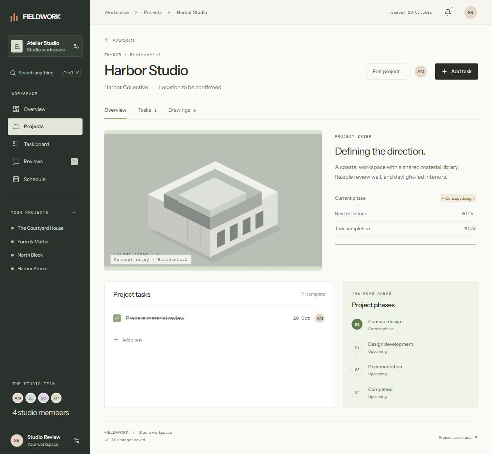
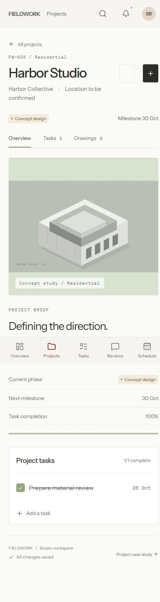

# FIELDWORK

A full-stack workspace for independent design studios. Projects, task assignments, drawing feedback and milestones share one place, with email/password accounts and PostgreSQL persistence.

**[Explore the static interface](https://ariyachan.github.io/fieldwork/)** · **[View the case study](https://ariyachan.github.io/fieldwork/case-study.html)** · **[API source and reference](server/README.md)**

The Pages site runs the browser-storage demo. Run full-stack mode below to inspect real accounts and the database-backed API. Both implementations are included in this repository.


## The workflow

- **Studio desk:** the current drawing, pinned feedback and decision queue lead the workspace; compact totals link to projects, reviews and tasks.
- **Projects:** searchable project library, create and edit projects, active/completed filters, project briefs, milestones and task progress.
- **Task board:** create assignments, move work between three states, filter by project and export the current task list as CSV.
- **Drawing reviews:** inspect sheets with fit-to-view and zoom, place comments with a pointer or keyboard, resolve or reopen feedback, download the drawing and approve the set after every open comment is resolved.
- **Schedule:** a desktop calendar and a phone agenda, both scoped to the selected month, with task deadlines and project milestones.
- **Search:** find projects and tasks with the global search or `Ctrl/⌘ K`.

The mobile layout puts the drawing first, stacks the decision queue and uses a full-width review sheet with a sticky approval bar. The desktop layout keeps studio navigation visible beside the desk; drawing and conversation panels scroll independently while approval stays in view.

<p align="center">
  
  
  
</p>

## Run locally

Node.js 22.18 or newer and npm.

```sh
npm ci
npm run dev
```

Open `http://localhost:5173/fieldwork/`.

### Full-stack mode



<p align="center"></p>

Use PostgreSQL and Node.js 22.18+. Install the server package with `npm ci` from `server/`, copy `server/.env.example` to `server/.env.local` and configure the database URL and authentication secret as described in the [server README](server/README.md).

In a server terminal, run `npm run migrate` then `npm start`. At the repository root, run `npm run dev:fullstack` and open `http://localhost:5173/fieldwork/`. Create a test account; its first workspace contains illustrative studio records, and subsequent changes persist in PostgreSQL. The Vite proxy forwards `/api` to port 4100.

For a built same-origin application, run `npm run build:fullstack` at the root and restart the server. Open `http://localhost:4100/fieldwork/`. Express serves the build and API together. `STATIC_DIR` overrides the default `../dist` directory.

For Docker Compose, copy root `.env.example` to `.env`, fill both values with independent generated URL-safe strings of at least 32 characters, then run `docker compose up --build`. Open `http://localhost:4100/fieldwork/`. The app binds to host loopback; PostgreSQL remains internal and persists in a named volume. Internet hosting requires HTTPS and matching server URLs/origins. Never commit environment files.

Compose follows the [official PostgreSQL 18 volume convention](https://github.com/docker-library/docs/blob/master/postgres/README.md#pgdata). Local verification used native Node and real PostgreSQL 18.4; the Docker engine was unavailable, so container startup has not been tested here.

```sh
npm test
npm run lint
npm run build
```

Full-stack checks also include `npm run build:fullstack` at the root and `npm run typecheck` / `npm test` from `server/` with the configured database. GitHub Actions runs the suites with a PostgreSQL service.

## Structure

```text
src/
  App.tsx            Navigation, project and task views
  StudioDesk.tsx     Drawing-led workspace and decision queue
  DrawingReview.tsx  Pinned feedback and approval workflow
  Schedule.tsx       Deadline calendar
  Plan.tsx           Drawing illustrations
  components.tsx     Shared interface components
  data.ts            Workspace records and state operations
  AuthGate.tsx       Account and session screens
  useWorkspace.ts    Persistence, save queue and revision conflicts
server/src/          Authenticated API, validation, migrations and queries
server/test/         HTTP/PostgreSQL integration checks
tests/               Workflow and state verification
public/              Images, case study and screenshots
docs/                Published site
```

Built with React and TypeScript. Radix primitives handle dialogs, tabs and status menus. Express, Better Auth, node-postgres and Zod provide the server. Authentication uses the library's session/password handling; SQL queries use bound parameters. The visual system uses Instrument Sans, warm neutrals, fine dividers, terracotta and architectural imagery.

## Project scope

An independent product project by Kai Zhang. Studio records and drawings are illustrative. Full-stack accounts have isolated personal workspaces; displayed studio members are example assignees, not shared team accounts or invitations. The static demo uses browser storage. There is no billing, email delivery, password-reset flow or live collaboration. Drawing illustrations are not construction documents.

Frontend checks cover project/task/review workflows, queued API saves and revision conflicts. Real HTTP/PostgreSQL integration checks cover registration, sessions, account isolation, project CRUD, validation, conflicting revisions, restart persistence and static hosting. See [server verification](server/verification.json).
