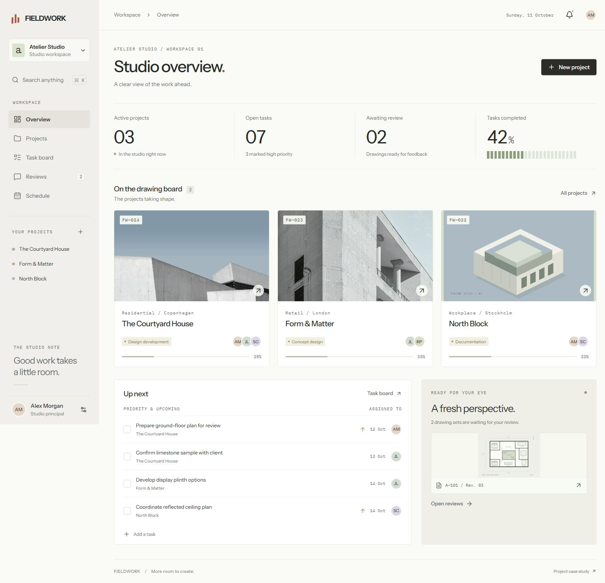
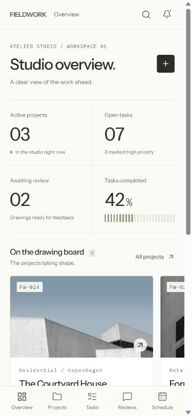
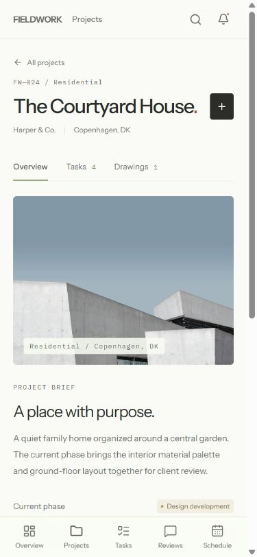
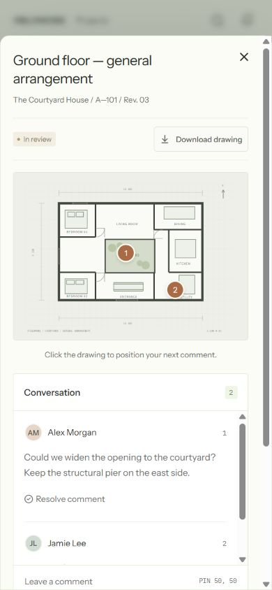

# FIELDWORK

A workspace for independent design studios. Project status, team assignments and drawing feedback share one place, from the first brief to the final handover.

**[Open the workspace](https://ariyachan.github.io/fieldwork/)** · **[View the case study](https://ariyachan.github.io/fieldwork/case-study.html)**



## The workflow

- **Studio overview:** active projects, open tasks and pending reviews, calculated from the workspace.
- **Projects:** searchable project library, active/completed filters, project briefs, milestones and task progress.
- **Task board:** create assignments, move work between three states, filter by project and export the current task list as CSV.
- **Drawing reviews:** place comments on an SVG drawing, resolve or reopen feedback, download the drawing and approve the set after every open comment is resolved.
- **Schedule:** browse months, follow task deadlines and open upcoming project milestones.
- **Search:** find projects and tasks with the global search or `Ctrl/⌘ K`.

The mobile layout uses a bottom navigation, horizontal project and task browsing, and a full-width drawing review sheet. The desktop layout keeps project navigation visible beside the workspace.

<p align="center">
  
  
  
</p>

## Run locally

Node.js 22.18 or newer and npm.

```sh
npm ci
npm run dev
```

Open `http://localhost:5173/fieldwork/`.

```sh
npm test
npm run lint
npm run build
```

## Structure

```text
src/
  App.tsx            Navigation, project and task views
  DrawingReview.tsx  Pinned feedback and approval workflow
  Schedule.tsx       Deadline calendar
  Plan.tsx           Drawing illustrations
  components.tsx     Shared interface components
  data.ts            Workspace records and state operations
  useWorkspace.ts    Browser persistence
tests/               Workflow and state verification
public/              Images, case study and screenshots
docs/                Published site
```

Built with React and TypeScript. Radix primitives handle dialogs, tabs and status menus. The visual system uses Instrument Sans, a restrained warm neutral palette, fine dividers, a single terracotta accent and architectural imagery.

## Project scope

A self-initiated product design and frontend project by Kai Zhang. The studio records are illustrative. Workspace changes persist in local browser storage; the project does not include a shared backend or multi-user synchronization. Drawing illustrations demonstrate the review interaction and are not construction documents.

Six automated checks cover scoped task progress, combined project filters, project creation and restoration, reversible task completion, review approval gates and task assignment. Desktop and mobile browser checks cover navigation, drawing comments, approval persistence and layout overflow.
